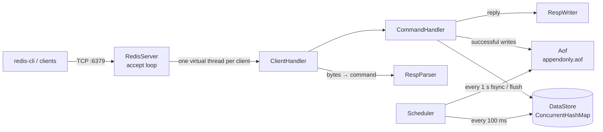

# redis-java

A Redis-compatible in-memory key-value server written from scratch in **Java 21**. It speaks the real **RESP protocol**, so the official `redis-cli` and `redis-benchmark` work against it unchanged. It serves concurrent clients on **virtual threads**, expires keys with **lazy + active expiry**, and persists data with an **append-only file (AOF)** that survives crashes.

## Features

- **RESP protocol parser** – arrays of bulk strings, inline commands, pipelining, binary-safe values
- **Commands** – `PING`, `ECHO`, `SET` (with `EX` / `PX` / `PXAT`), `GET`, `DEL`, `EXISTS`, `EXPIRE`, `PEXPIREAT`, `TTL`, `DBSIZE`
- **Concurrency** – one Java 21 virtual thread per client, sharing a thread-safe `ConcurrentHashMap` store
- **Key expiry** – lazy expiry on every read plus a background cleaner every 100 ms, with race-safe conditional updates
- **AOF persistence** – write-ahead log in RESP, replayed on startup, with `always` / `everysec` / `no` fsync policies and automatic repair of a truncated last command
- **Tests** – JUnit 5 tests for the parser and the store

## Quick start

Requires **Java 21+** and **Maven**. Install the Redis tools for `redis-cli` and `redis-benchmark` (`brew install redis` on macOS).

```bash
git clone https://github.com/addythakur98/redis-java.git
cd redis-java
mvn -q clean compile
java -cp target/classes com.saksham.App            # default fsync policy: everysec
java -cp target/classes com.saksham.App always     # or: always | everysec | no
```

The server listens on port **6379**. In another terminal:

```bash
redis-cli set name jay
redis-cli get name
redis-cli set otp 4821 EX 60
redis-cli ttl otp
```

Run the tests with `mvn test`.

## Supported commands

| Command | Example | Reply |
|---|---|---|
| `PING [msg]` | `PING` | `PONG` (or `msg` as a bulk string) |
| `ECHO msg` | `ECHO hello` | `"hello"` |
| `SET key value [EX s \| PX ms \| PXAT unix-ms]` | `SET otp 4821 EX 60` | `OK` |
| `GET key` | `GET name` | value, or `(nil)` |
| `DEL key [key ...]` | `DEL a b` | number of keys deleted |
| `EXISTS key [key ...]` | `EXISTS a b` | number of keys that exist |
| `EXPIRE key seconds` | `EXPIRE name 3600` | `1` if set, `0` if no such key |
| `PEXPIREAT key unix-ms` | `PEXPIREAT name 1730000000000` | `1` / `0` |
| `TTL key` | `TTL otp` | seconds left, `-1` no expiry, `-2` no key |
| `DBSIZE` | `DBSIZE` | number of keys in memory |

## Architecture



```
src/main/java/com/saksham/
├── App.java                     entry point, reads the fsync policy
├── server/
│   ├── RedisServer.java         replay AOF, start scheduler, accept clients
│   └── ClientHandler.java       read command → execute → write reply
├── protocol/
│   ├── RespParser.java          RESP / inline parsing (binary-safe, pipelining)
│   └── RespWriter.java          simple strings, bulk strings, errors, integers
├── command/
│   └── CommandHandler.java      command logic + AOF logging
├── store/
│   └── DataStore.java           ConcurrentHashMap + lazy & active expiry
└── persistence/
    └── Aof.java                 append, fsync policies, replay, truncation repair
```

## Design decisions

- **Virtual threads, blocking I/O.** Each client gets a cheap Java 21 virtual thread, so the code stays simple (blocking `read()`) while still scaling to hundreds of connections.
- **`ConcurrentHashMap`.** All client threads share one store; fine-grained internal locking avoids a global lock.
- **Length-prefixed parsing.** Values are read by their declared byte length, so they can contain any bytes, including `\r\n`. Pipelined commands arriving in a single TCP read are each parsed and answered.
- **Absolute expiry timestamps.** Keys store *when* they expire, not how long they have left, so expiry is one comparison.
- **Lazy + active expiry.** Reads never see an expired key, and a background task every 100 ms removes expired keys nobody reads.
- **Race-safe updates.** The cleaner and `EXPIRE` use conditional `remove(key, old)` / `replace(key, old, new)`, so they never overwrite a value another client just wrote.
- **AOF in RESP.** The log uses the wire format, so replay reuses the same parser. Relative TTLs are rewritten as absolute times (`EX` → `PXAT`, `EXPIRE` → `PEXPIREAT`) so a restart doesn't extend them.
- **Truncation repair.** If a crash leaves a half-written command at the end of the log, replay loads everything before it and truncates the file to the last complete command.

## Benchmarks

Measured with the official `redis-benchmark` on an **Apple M1 MacBook Air, 8 GB RAM**, `-n 100000`. Requests per second; laptop numbers vary between runs.

**Throughput vs. real Redis** (same machine, 50 clients)

| Test | redis-java | Redis | redis-java as % of Redis |
|---|---:|---:|---:|
| SET | 137,174 | 150,830 | 91% |
| GET | 120,627 | 161,290 | 75% |
| PING | 131,579 | 158,228 | 83% |
| SET, pipelined (`-P 16`) | 581,395 | 1,639,344 | 35% |
| GET, pipelined (`-P 16`) | 961,538 | 2,127,660 | 45% |

With **500 concurrent clients**: SET 124,378/s (p50 1.9 ms), GET 105,932/s (p50 2.2 ms).

**AOF fsync policy** (SET, 50 clients)

| Policy | SET/s | p50 latency | Data at risk on crash |
|---|---:|---:|---|
| `always` | 265 | 190 ms | none |
| `everysec` (default) | 112,740 | 0.26 ms | up to ~1 second |
| `no` | 102,669 | 0.27 ms | up to the OS flush interval |

Without pipelining, network round trips dominate and redis-java stays within 75–91% of Redis. With pipelining, Redis's C implementation (no garbage collector, single-threaded event loop, minimal buffer copying) pulls ahead.

## Limitations and future work

- Strings only: no lists, hashes, sets or sorted sets
- **AOF rewrite**: compact the log by writing one `SET` per live key
- **Group commit** for `appendfsync always`: batch concurrent writers into one fsync
- An NIO event-loop server mode to compare against virtual threads
- `CONFIG GET` support (removes the `redis-benchmark` warning)
- Replication